# Árvore Sintática Abstrata (AST)

A Árvore Sintática Abstrata é a representação intermediária produzida pelo parser após validar a sintaxe do código-fonte. Diferentemente da árvore de derivação concreta (parse tree), a AST omite detalhes sintáticos (parênteses, dois-pontos, tokens `NEWLINE`/`INDENT`/`DEDENT`) e retém apenas a estrutura semântica do programa.

## Motivação

A AST serve como contrato estrutural entre o *front-end* (Lexer e Parser) e as etapas posteriores do compilador (Análise Semântica, Geração de Código Intermediário TAC e Geração de Código C#). Construída automaticamente durante as reduções do Bison em `parser/parser.y`, ela armazena a hierarquia de comandos e expressões, a linha de origem de cada construção (`linha`) e o tipo inferido pela análise semântica (`tipo_resolvido`).

## Módulo `ast.h` / `ast.c`

Os arquivos ficam em `src/ast.h` e `src/ast.c`, seguindo o padrão de modularização e gerenciamento de memória (*ownership*) do projeto.

---

## Tipos de Nós (`TipoNo`) e Matriz Completa de Campos

Cada nó da AST tem um tipo definido pelo enum `TipoNo` que identifica a construção sintática que ele representa. A struct `NoAST` (`src/ast.h`) adota uma estrutura genérica compartilhada para todos os nós da árvore. A tabela a seguir documenta a **matriz bidimensional completa `TipoNo × campo`**, conferida com as implementações dos construtores em [`src/ast.c`](../src/ast.c) e utilizada nas fases de Análise Semântica e Geração de Código:

| Tipo de Nó (`TipoNo`) | `nome` | `valor_*` | `operador` | `esquerda` | `direita` | `condicao` | `bloco_if` | `bloco_else` | `argumentos` / `num_argumentos` | `tipo_resolvido` | `linha` |
|---|---|---|---|---|---|---|---|---|---|---|---|
| `NO_NUM_INT` | — | `valor_int` | — | — | — | — | — | — | — | `TIPO_INT` | Linha literal |
| `NO_NUM_FLOAT` | — | `valor_float` | — | — | — | — | — | — | — | `TIPO_FLOAT` | Linha literal |
| `NO_STRING` | — | `valor_string` | — | — | — | — | — | — | — | `TIPO_STRING` | Linha literal |
| `NO_BOOL` | — | `valor_int` (1/0) | — | — | — | — | — | — | — | `TIPO_BOOL` | Linha literal |
| `NO_ID` | `nome` | — | — | — | — | — | — | — | — | Tipo do símbolo | Linha identificador |
| `NO_BINOP` | — | — | `operador` | Filho esquerdo | Filho direito | — | — | — | — | Tipo da operação | Linha operação |
| `NO_UNARYOP` | — | — | `operador` | Operando único | — | — | — | — | — | Tipo da operação | Linha operador |
| `NO_ASSIGN` | `nome` (alvo) | — | — | Expr atribuída | — | — | — | — | — | — | Linha atribuição |
| `NO_PRINT` | — | — | — | — | — | — | — | — | Lista de expressões | — | Linha do print |
| `NO_INPUT` | — | — | — | Prompt (opc.) | — | — | — | — | — | `TIPO_STRING` | Linha do input |
| `NO_IF` | — | — | — | — | — | Condição if | Bloco then | Bloco else | Lista nós `NO_ELIF` | — | Linha do if |
| `NO_ELIF` | — | — | — | — | — | Condição elif | Bloco do elif | — | — | — | Linha do elif |
| `NO_WHILE` | — | — | — | — | — | Condição while | Corpo do laço | — | — | — | Linha do while |
| `NO_FOR` | `nome` (var) | — | — | Args do range | — | — | Corpo do laço | — | — | — | Linha do for |
| `NO_FUNCDEF` | `nome` (func) | — | — | — | — | — | Corpo da função | — | Lista parâmetros (`NO_ID`) | Tipo retorno | Linha do def |
| `NO_RETURN` | — | — | — | Expr retorno | — | — | — | — | — | Tipo retorno | Linha do return |
| `NO_FUNCCALL` | `nome` (func) | — | — | — | — | — | — | — | Lista argumentos | Tipo retorno | Linha chamada |
| `NO_BLOCO` | — | — | — | — | — | — | — | — | Lista de comandos | — | — |
| `NO_PROGRAMA` | — | — | — | — | — | — | — | — | Comandos top-level | — | — |

---

## Catálogo Estrutural dos 19 Tipos de Nó

Abaixo, cada nó da AST é ilustrado com um trecho de código Python de exemplo e a respectiva estrutura gerada em memória:

### 1. Literais e Identificadores

#### `NO_NUM_INT`
- **Exemplo:** `42`
- **Campos:** `tipo = NO_NUM_INT`, `valor_int = 42`, `tipo_resolvido = TIPO_INT`.
- **Estrutura:** `[NO_NUM_INT: 42]`

#### `NO_NUM_FLOAT`
- **Exemplo:** `3.14`
- **Campos:** `tipo = NO_NUM_FLOAT`, `valor_float = 3.14`, `tipo_resolvido = TIPO_FLOAT`.
- **Estrutura:** `[NO_NUM_FLOAT: 3.14]`

#### `NO_STRING`
- **Exemplo:** `"ola mundo"`
- **Campos:** `tipo = NO_STRING`, `valor_string = "ola mundo"`, `tipo_resolvido = TIPO_STRING`.
- **Estrutura:** `[NO_STRING: "ola mundo"]`

#### `NO_BOOL`
- **Exemplo:** `True`
- **Campos:** `tipo = NO_BOOL`, `valor_int = 1`, `tipo_resolvido = TIPO_BOOL`.
- **Estrutura:** `[NO_BOOL: True]`

#### `NO_ID`
- **Exemplo:** `x`
- **Campos:** `tipo = NO_ID`, `nome = "x"`, `tipo_resolvido = (definido na semântica)`.
- **Estrutura:** `[NO_ID: x]`

---

### 2. Operações e Expressões

#### `NO_BINOP`
- **Exemplo:** `a + 10`
- **Construtor:** `criar_no_binop(OP_SOMA, no_a, no_10, linha)`
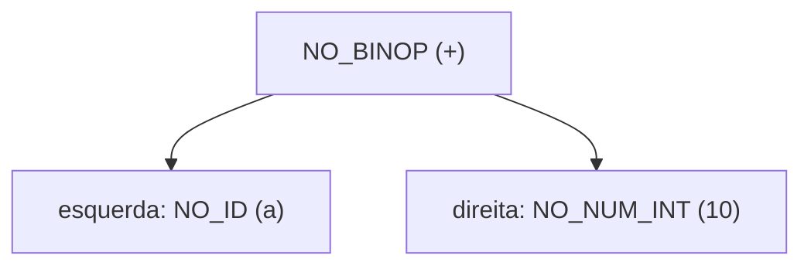

#### `NO_UNARYOP`
- **Exemplo:** `-x` ou `not flag`
- **Construtor:** `criar_no_unaryop(OP_NEG, no_x, linha)`
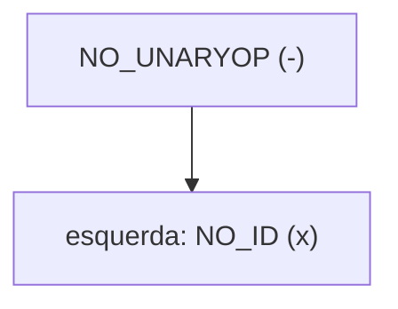

#### `NO_INPUT`
- **Exemplo:** `input("Digite seu nome: ")`
- **Construtor:** `criar_no_input(no_prompt, linha)`
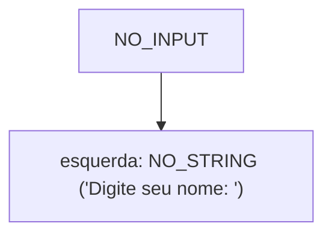

---

### 3. Atribuição e Comandos Básicos

#### `NO_ASSIGN`
- **Exemplo:** `x = y + 1`
- **Construtor:** `criar_no_assign("x", no_expr, linha)`
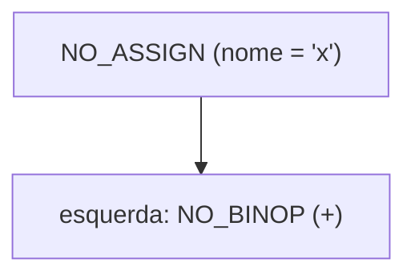

#### `NO_PRINT`
- **Exemplo:** `print(a, b)`
- **Construtor:** `criar_no_print(args, 2, linha)`
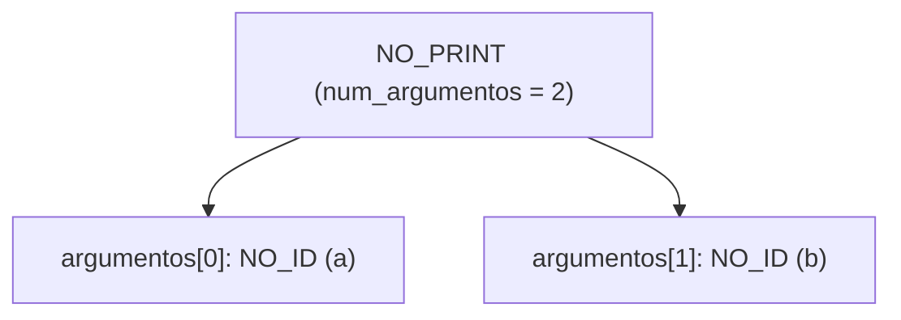

---

### 4. Estruturas de Controle de Fluxo

#### `NO_IF` e `NO_ELIF`
- **Exemplo:**
  ```python
  if x > 0:
      print(1)
  elif x < 0:
      print(-1)
  else:
      print(0)
  ```
- **Construtor:** `criar_no_if(cond, bloco_if, elifs, 1, bloco_else, linha)`
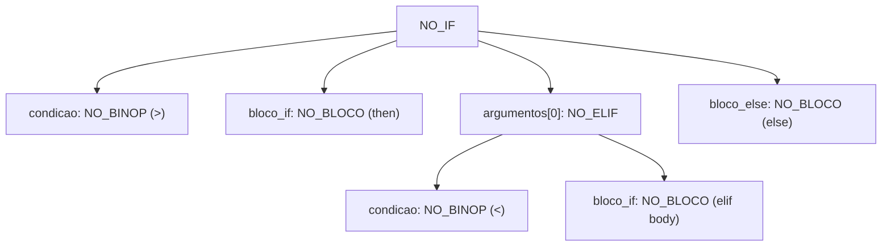

#### `NO_WHILE`
- **Exemplo:**
  ```python
  while count > 0:
      count = count - 1
  ```
- **Construtor:** `criar_no_while(cond, bloco, linha)`
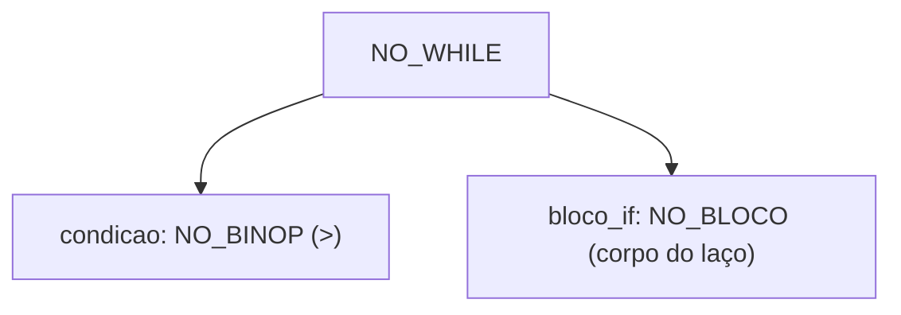

#### `NO_FOR`
- **Exemplo:**
  ```python
  for i in range(10):
      print(i)
  ```
- **Construtor:** `criar_no_for("i", no_range, bloco, linha)`
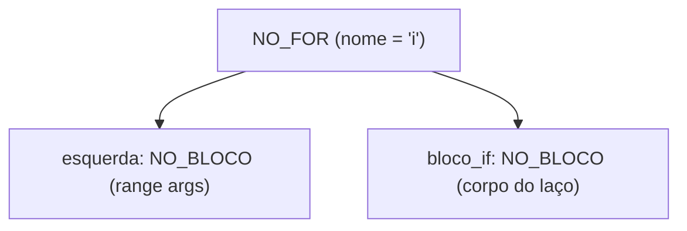

---

### 5. Funções e Agrupamentos

#### `NO_FUNCDEF`
- **Exemplo:**
  ```python
  def soma(a, b):
      return a + b
  ```
- **Construtor:** `criar_no_funcdef("soma", params, 2, bloco, linha)`
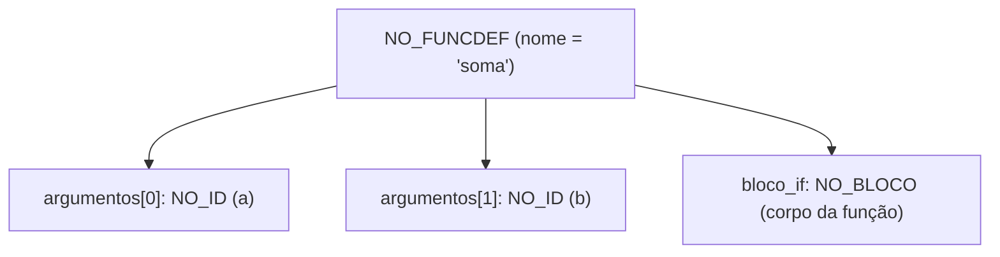

#### `NO_RETURN`
- **Exemplo:** `return x * 2`
- **Construtor:** `criar_no_return(expr, linha)`
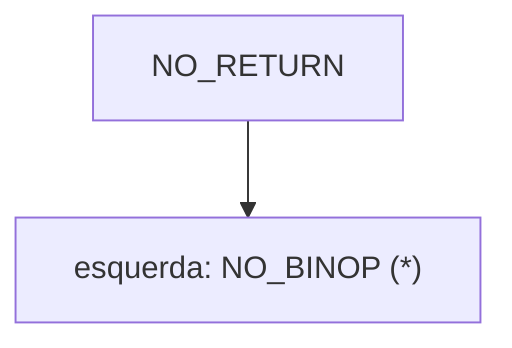

#### `NO_FUNCCALL`
- **Exemplo:** `soma(3, 4)`
- **Construtor:** `criar_no_funccall("soma", args, 2, linha)`
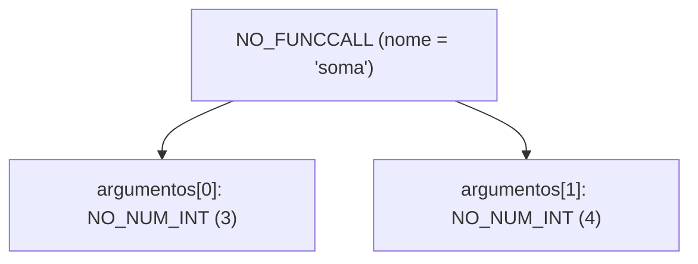

#### `NO_BLOCO` e `NO_PROGRAMA`
- **Exemplo:** O programa raiz reúne os comandos top-level em `argumentos`, e blocos indentados agrupam comandos subordinados.
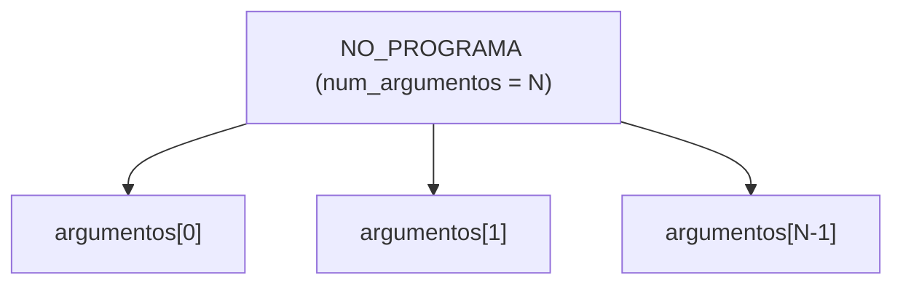

---

## Macros de Acesso Semântico e Proposta de Refatoração (Issue #42)

### 1. Macros Semânticas de Conveniência

Para tornar as fases de **Análise Semântica** e **Geração de Código** mais legíveis e evitar erros conceituais ao navegar pelos campos reaproveitados da struct `NoAST`, propõem-se as seguintes macros de acesso padronizadas:

```c
/* ── Funções ─────────────────────────────────────────────────────── */
#define CORPO_FUNCAO(n)       ((n)->bloco_if)
#define PARAMS_FUNCAO(n)      ((n)->argumentos)
#define NUM_PARAMS_FUNCAO(n)  ((n)->num_argumentos)

/* ── Atribuição e Variáveis ──────────────────────────────────────── */
#define VAR_ASSIGN(n)         ((n)->nome)
#define EXPR_ASSIGN(n)        ((n)->esquerda)

/* ── Laços de Repetição ──────────────────────────────────────────── */
#define VAR_FOR(n)            ((n)->nome)
#define RANGE_FOR(n)          ((n)->esquerda)
#define CORPO_FOR(n)          ((n)->bloco_if)
#define COND_WHILE(n)         ((n)->condicao)
#define CORPO_WHILE(n)        ((n)->bloco_if)

/* ── Condicionais (if / elif / else) ─────────────────────────────── */
#define COND_IF(n)            ((n)->condicao)
#define BLOCO_THEN(n)         ((n)->bloco_if)
#define BLOCO_ELSE(n)         ((n)->bloco_else)
#define ELIFS_IF(n)           ((n)->argumentos)
#define NUM_ELIFS_IF(n)       ((n)->num_argumentos)

/* ── Chamadas, Retorno e Entrada ─────────────────────────────────── */
#define EXPR_RETURN(n)        ((n)->esquerda)
#define PROMPT_INPUT(n)       ((n)->esquerda)
#define ARGS_FUNCCALL(n)      ((n)->argumentos)
#define NUM_ARGS_CALL(n)      ((n)->num_argumentos)
```

### 2. Avaliação Arquitetural: Macros vs. `union`

| Aspecto | Abordagem com Macros (Proposta) | Abordagem com `tagged union` |
|---|---|---|
| **Compatibilidade** | 100% retrocompatível com código e testes existentes. | Quebra todos os arquivos que acessam campos diretamente (`.esquerda`, etc.). |
| **Consumo de Memória** | Struct plana (64 bytes por nó). | Economia potencial de 20–30 bytes por nó. |
| **Clareza de Código** | Nomes semânticos claros (`CORPO_FUNCAO(n)`). | Nomes aninhados explícitos (`n->dado.funcdef.corpo`). |
| **Impacto no Projeto** | Risco zero de regressão em branches ativas. | Alto esforço de refatoração em `parser.y`, `ast.c`, `semantica.c`, `codegen`. |

**Conclusão e Decisão:** Mantém-se a estrutura `NoAST` existente em `src/ast.h` intacta sem alterações estruturais no código-fonte, documentando a matriz 2D completa e apresentando as macros acima como proposta de abstração semântica para discussão com o grupo.

---

## Estrutura do Nó (`NoAST`)

Todos os nós compartilham uma única struct `NoAST` com campos que são usados conforme o `TipoNo`:

```c
typedef struct noAST {
    TipoNo tipo;

    /* Literais e identificadores */
    int    valor_int;
    double valor_float;
    char  *valor_string;
    char  *nome;

    /* Operador para BinOp e UnaryOp (ex: '+', '-', OP_AND, OP_NOT, etc.) */
    int operador;

    /* Tipo resolvido pela análise semântica (usado na checagem e geração de código) */
    TipoDado tipo_resolvido;

    /* Filhos principais (condição, expressão) */
    struct noAST *condicao;
    struct noAST *esquerda;
    struct noAST *direita;

    /* Blocos de código */
    struct noAST *bloco_if;
    struct noAST *bloco_else;

    /* Lista encadeada/dinâmica (elif, argumentos, parâmetros, comandos) */
    struct noAST **argumentos;
    int num_argumentos;

    /* Informação de localização para mensagens de erro */
    int linha;
} NoAST;
```

---

## Operadores (`TipoOperador`)

Operadores binários e unários são representados por um enum separado para evitar ambiguidade com os tokens do Bison:

| Valor              | Operação  |
|--------------------|-----------|
| `OP_SOMA`          | `+`       |
| `OP_SUB`           | `-`       |
| `OP_MULT`          | `*`       |
| `OP_DIV`           | `/`       |
| `OP_EQ`            | `==`      |
| `OP_NEQ`           | `!=`      |
| `OP_GT`            | `>`       |
| `OP_LT`            | `<`       |
| `OP_GTE`           | `>=`      |
| `OP_LTE`           | `<=`      |
| `OP_AND`           | `and`     |
| `OP_OR`            | `or`      |
| `OP_NOT`           | `not`     |
| `OP_NEG`           | `-` (unário) |
| `OP_IN`            | `in`      |

---

## Funções da API

### Construtores

Cada tipo de nó possui uma função construtora que aloca o nó, inicializa seus campos e retorna o ponteiro:

| Função                                                              | Descrição                          |
|---------------------------------------------------------------------|------------------------------------|
| `criar_no_int(int valor, int linha)`                                | Cria nó `NO_NUM_INT`              |
| `criar_no_float(double valor, int linha)`                           | Cria nó `NO_NUM_FLOAT`            |
| `criar_no_string(char *valor, int linha)`                           | Cria nó `NO_STRING`               |
| `criar_no_bool(int valor, int linha)`                               | Cria nó `NO_BOOL`                 |
| `criar_no_id(char *nome, int linha)`                                | Cria nó `NO_ID`                   |
| `criar_no_binop(int op, NoAST *esq, NoAST *dir, int linha)`        | Cria nó `NO_BINOP`                |
| `criar_no_unaryop(int op, NoAST *operando, int linha)`              | Cria nó `NO_UNARYOP`              |
| `criar_no_assign(char *nome, NoAST *expr, int linha)`               | Cria nó `NO_ASSIGN`               |
| `criar_no_print(NoAST **args, int num_args, int linha)`             | Cria nó `NO_PRINT`                |
| `criar_no_input(NoAST *prompt, int linha)`                          | Cria nó `NO_INPUT`                |
| `criar_no_if(NoAST *cond, NoAST *bloco, NoAST **elifs, int n_elifs, NoAST *else_bloco, int linha)` | Cria nó `NO_IF` |
| `criar_no_elif(NoAST *cond, NoAST *bloco, int linha)`              | Cria nó `NO_ELIF`                 |
| `criar_no_while(NoAST *cond, NoAST *bloco, int linha)`             | Cria nó `NO_WHILE`                |
| `criar_no_for(char *var, NoAST *range, NoAST *bloco, int linha)`   | Cria nó `NO_FOR`                  |
| `criar_no_funcdef(char *nome, NoAST **params, int n_params, NoAST *bloco, int linha)` | Cria nó `NO_FUNCDEF` |
| `criar_no_return(NoAST *expr, int linha)`                           | Cria nó `NO_RETURN`               |
| `criar_no_funccall(char *nome, NoAST **args, int n_args, int linha)` | Cria nó `NO_FUNCCALL`           |
| `criar_no_bloco(NoAST **cmds, int n_cmds)`                         | Cria nó `NO_BLOCO`                |
| `criar_no_programa(NoAST **cmds, int n_cmds)`                      | Cria nó `NO_PROGRAMA`             |

### Utilitários

| Função                          | Descrição                                                          |
|---------------------------------|--------------------------------------------------------------------|
| `imprimir_ast(NoAST *raiz, int nivel)` | Imprime a árvore formatada com indentação para debug          |
| `ast_para_dot(NoAST *raiz, FILE *saida)` | Exporta a árvore no formato Graphviz DOT                    |
| `liberar_ast(NoAST *raiz)`             | Libera toda a memória da árvore recursivamente                 |

---

## Exemplo e Representação Visual

Para o código de exemplo:
```python
x = 10 + 5
print(x)
```

A saída textual de `imprimir_ast` (após a anotação de `tipo_resolvido` pela Análise Semântica) é:
```text
Programa
  Assign: x
    BinOp: + [int]
      NumInt: 10 [int]
      NumInt: 5 [int]
  Print
    Id: x [int]
```

E a estrutura em árvore correspondente gerada na memória é:

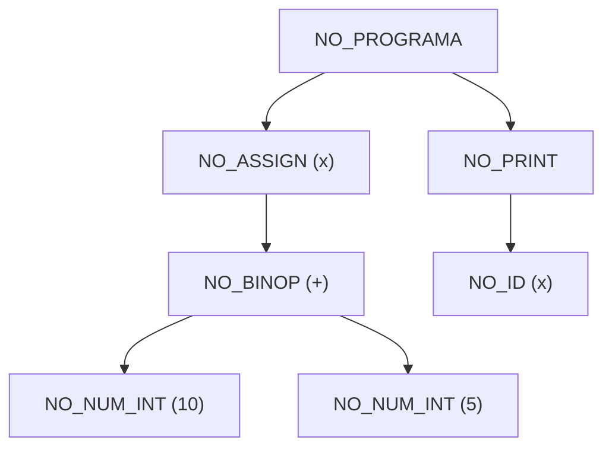

---

## Integração com o Parser

A integração da AST com o analisador sintático (`parser/parser.y`) foi concluída utilizando ações semânticas do Bison para construir a árvore de baixo para cima (*bottom-up*) durante a análise gramatical. O processo envolveu as seguintes modificações estruturais:

### 1. Configuração Global e Tipagem
* **Cabeçalhos:** Adição de `#include "src/ast.h"` no prólogo do parser e declaração da variável global `NoAST *raiz_ast;` para armazenar a raiz da árvore completa.
* **Expansão do `%union`:** Inclusão do ponteiro `struct noAST *ast` no `%union` do Bison para permitir a navegação de nós entre as regras.
* **Tipagem Dinâmica:** Declaração de `%type <ast>` para todos os não-terminais que representam comandos, expressões ou blocos. O token de identificador foi ajustado para `%token <sval> ID` para transportar o nome das variáveis e funções.

### 2. Ações Semânticas e Construtores
* Em cada regra gramatical, foram adicionadas ações no formato `{ $$ = criar_no_*(...); }` utilizando a API de construtores.
* A variável global `linha_token` (gerenciada pelo lexer) foi repassada no último parâmetro de todas as chamadas `criar_no_*` para garantir a rastreabilidade exata em caso de erros semânticos.

### 3. Gerenciamento de Listas Dinâmicas
Como a análise do Bison é reduzida de baixo para cima, o tamanho final de blocos de código ou listas de argumentos não é conhecido previamente.
* Foram implementadas as funções auxiliares `criar_lista()` e `adicionar_lista()` no prólogo do `parser.y`.
* Essas funções utilizam nós genéricos do tipo `NO_BLOCO` temporariamente para acumular o vetor `**argumentos` dinamicamente via `malloc`/`realloc`, repassando-os em seguida para construtores estruturados como `criar_no_if`, `criar_no_print` e `criar_no_funcdef`.

### 4. Integração com o Analisador Léxico
Para garantir que a árvore receba dados válidos sem gerar falhas de segmentação (*Segmentation Fault*), o analisador léxico (`lexer/lexer.l`) foi atualizado. A regra para identificadores (`ID`) agora realiza a alocação de memória do texto usando `yylval.sval = strdup(yytext);`.

### 5. Saída, Validação e Flags `--ast` e `--dot`
A função `main()` do compilador repassa a raiz para a Análise Semântica via `analisar_semantica(raiz_ast, tabela)` (que preenche o `tipo_resolvido` de cada expressão) e, caso a flag `--ast` seja informada na linha de comando, invoca `imprimir_ast(raiz_ast, 0)` exibindo os nós da árvore e seus respectivos tipos resolvidos:

```bash
./compilador --ast < testes/Testes1.py
```

Para exportar a AST no formato Graphviz DOT e gerar uma imagem visual (além de salvar e abrir automaticamente `ast.png` ao usar a flag `--dot`), utilize:

```bash
./compilador --dot < x.py > x.dot && dot -Tpng x.dot -o x.png
```

---

## Visualização com Graphviz (`--dot`)

Abaixo estão 3 exemplos gerados pelo compilador usando `--dot` e renderizados com Graphviz (`dot -Tpng`):

### 1. Condicional (`if / elif / else`)

```python
x = 10
if x > 10:
    print("maior")
elif x == 10:
    print("igual")
else:
    print("menor")
```

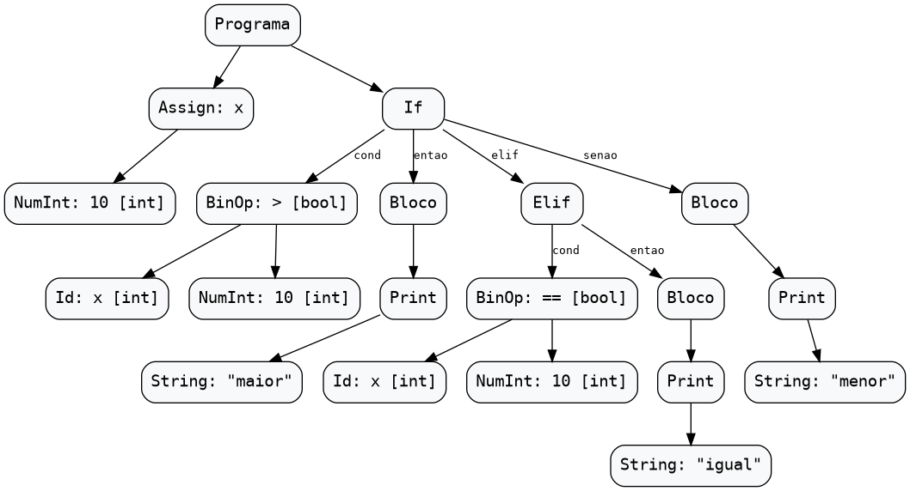

### 2. Laço de Repetição (`for` com `range`)

```python
soma = 0
for i in range(5):
    soma = soma + i
print(soma)
```

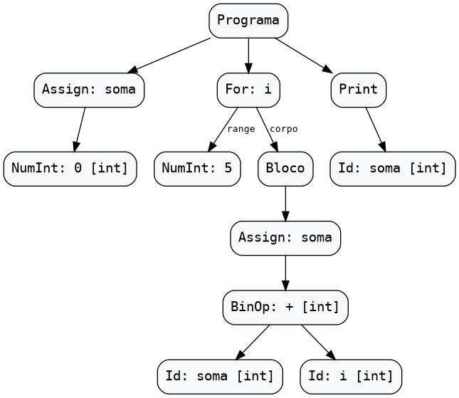

### 3. Definição e Chamada de Função (`def` + chamada)

```python
def dobro(n):
    return n * 2
res = dobro(5)
print(res)
```

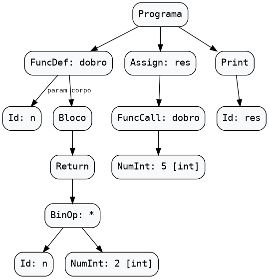

---

## Testes Unitários (TDD)

O módulo AST conta com testes unitários em [`testes/tdd/teste_ast.c`](../testes/tdd/teste_ast.c), cobrindo a alocação e verificação de todos os nós, listas encadeadas/dinâmicas e desalocação recursiva de memória.

Para compilar e executar os testes unitários da AST:
```bash
make test_ast
```

---

## Referências

- Implementação: [`src/ast.h`](../src/ast.h) e [`src/ast.c`](../src/ast.c)
- Suíte de Testes: [`testes/tdd/teste_ast.c`](../testes/tdd/teste_ast.c)
- Exemplo da disciplina: `Aulas/semana 06/src/ast.h` e `ast.c`
- Issues relacionadas: #7 (AST) e #19 (Documentação AST e Tabela de Símbolos)
