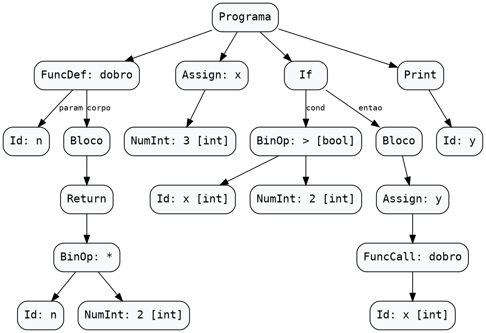

# Vida de um Programa no Compilador

Este documento acompanha um único programa Python por todas as fases do compilador — da leitura dos caracteres no **Lexer**, passando pela redução das regras no **Parser**, construção da **AST**, gerenciamento de escopos na **Tabela de Símbolos** e validação na **Análise Semântica**.

## Programa de Exemplo

```python
def dobro(n):
    return n * 2
x = 3
if x > 2:
    y = dobro(x)
print(y)
```

---

## 1. Análise Léxica (Lexer)


---

## 2. Análise Sintática (Parser)


---

## 3. Árvore Sintática Abstrata (AST)


Após o `yyparse()` concluir as reduções sintáticas de baixo para cima (*bottom-up*), a variável global `raiz_ast` aponta para o nó raiz `NO_PROGRAMA`, que reúne os **4 comandos de topo** no vetor `raiz_ast->argumentos` (`num_argumentos = 4`):

1. **`argumentos[0]` — Definição de função (`NO_FUNCDEF: dobro`)**:
   - `nome`: `"dobro"`
   - `argumentos[0]` (parâmetro): `NO_ID ("n")`
   - `bloco_if` (corpo da função): `NO_BLOCO` contendo um único comando `NO_RETURN`, cujo filho `esquerda` é a expressão binária `NO_BINOP (OP_MULT: *)` ligando `NO_ID ("n")` (à esquerda) e `NO_NUM_INT (2)` (à direita).
2. **`argumentos[1]` — Atribuição (`NO_ASSIGN: x`)**:
   - `nome`: `"x"`
   - `esquerda`: literal `NO_NUM_INT (3)` anotado pela semântica com `tipo_resolvido = TIPO_INT`.
3. **`argumentos[2]` — Condicional (`NO_IF`)**:
   - `condicao`: `NO_BINOP (OP_GT: >)` comparando `NO_ID ("x")` (`[int]`) e `NO_NUM_INT (2)` (`[int]`), anotado com `tipo_resolvido = TIPO_BOOL`.
   - `bloco_if` (ramo `entao`): `NO_BLOCO` contendo `NO_ASSIGN ("y")`, cujo filho `esquerda` é a chamada `NO_FUNCCALL ("dobro")` passando `NO_ID ("x")` (`[int]`) em `argumentos[0]`.
   - `bloco_else`: `NULL` (e `num_argumentos = 0`, pois não há cláusulas `elif`).
4. **`argumentos[3]` — Comando de saída (`NO_PRINT`)**:
   - `argumentos[0]`: `NO_ID ("y")`.

### Saída Textual (`--ast`)

Executando o compilador com a flag `--ast`:

```bash
./compilador --ast < exemplo.py
```

Obtemos a árvore indentada com os tipos resolvidos anotados entre colchetes (`[int]`, `[bool]`):

```text
Programa
  FuncDef: dobro
    Params:
      Id: n
    Corpo:
      Bloco
        Return
          BinOp: *
            Id: n
            NumInt: 2 [int]
  Assign: x
    NumInt: 3 [int]
  If
    Cond:
      BinOp: > [bool]
        Id: x [int]
        NumInt: 2 [int]
    Entao:
      Bloco
        Assign: y
          FuncCall: dobro
            Id: x [int]
  Print
    Id: y
```

### Visualização Gráfica (`--dot`)

Executando o compilador com a flag `--dot`:

```bash
./compilador --dot < exemplo.py > exemplo.dot && dot -Tpng exemplo.dot -o docs/img/ast_vida_programa.png
```

O módulo [`src/ast.c`](../src/ast.c) exporta os 20 nós (`n0` a `n19`) no formato Graphviz DOT e renderiza a árvore final abaixo:


<details>
<summary>Ver código Graphviz DOT gerado por <code>ast_para_dot</code></summary>


</details>

---

## 4. Tabela de Símbolos


---

## 5. Análise Semântica

