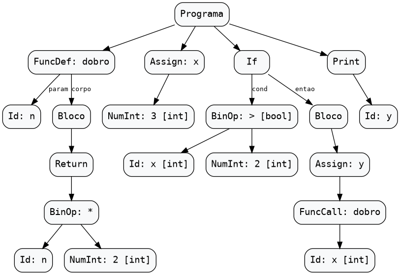
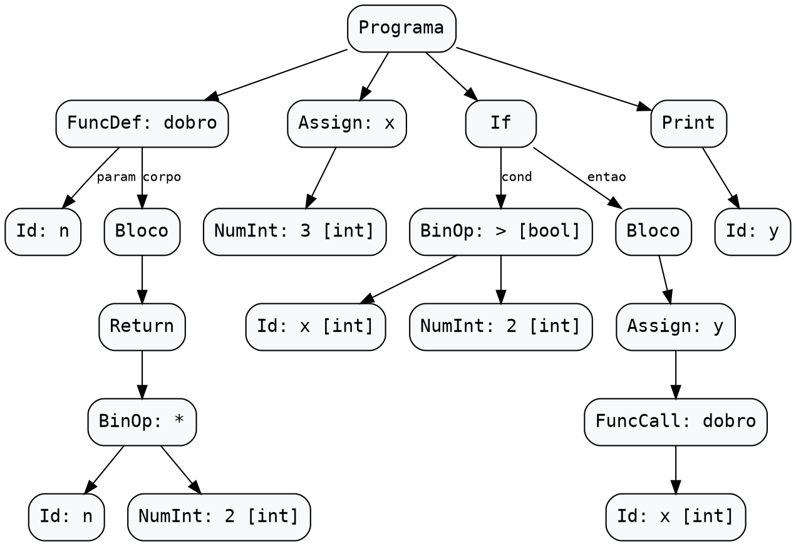

# Vida de um Programa no Compilador

Este documento acompanha um único programa Python por todas as fases do compilador — da leitura dos caracteres no **Lexer**, passando pela redução das regras no **Parser**, construção da **AST**, gerenciamento de escopos na **Tabela de Símbolos** e validação na **Análise Semântica**.

## Programa de Exemplo

```python
def dobro(n):
    return n * 2
x = 3
if x > 2:
    y = dobro(x)
print(y)
```

---

## 1. Análise Léxica (Lexer)

A análise léxica é a primeira fase do processo de compilação. Sua função é ler o código-fonte, identificar as sequências de caracteres que formam as unidades léxicas da linguagem e classificá-las em tokens. Esses tokens são enviados ao analisador sintático, responsável por verificar se a sequência obedece às regras gramaticais da linguagem. O componente responsável por essa tarefa é chamado de analisador léxico, também conhecido como lexer ou scanner. Essa tarefa pode ser dividida em algumas etapas:

#### Leitura de caracteres

- Ele analisa cada caractere do código-fonte (um fluxo de texto). Nessa leitura, ocorre a remoção de caracteres irrelevantes, como espaços em branco ou comentários. Entretanto, esse comportamento depende das regras da linguagem.

#### Agrupamento e classificação

- Enquanto ocorre a leitura, o analisador agrupa os caracteres relevantes em lexemas e os classifica, gerando uma lista de tokens, que são os símbolos processados pelas demais etapas.

#### Reconhecimento e classificação dos lexemas
- Ao receber o código-fonte como um fluxo de caracteres, o analisador léxico identifica as sequências que correspondem aos padrões definidos pela linguagem, classificando-as e gerando os tokens correspondentes. Além disso, pode ignorar elementos que não precisam ser enviados às próximas etapas, como espaços em branco e comentários, dependendo das regras da linguagem. No Python, entretanto, nem todo espaço em branco é irrelevante, pois a indentação determina a estrutura dos blocos de código. Por isso, o analisador léxico pode gerar tokens específicos, como `INDENT` e `DEDENT`, que representam, respectivamente, o aumento e a diminuição do nível de indentação.

### Conceitos

Dessa forma, pode-se definir três tipos de relacionamentos ao implementar um analisador léxico:

- **Lexema:** é uma sequência de caracteres de um programa-fonte, como uma palavra. Cada conjunto de caracteres forma um símbolo válido de uma linguagem de programação. O lexema pode ser também um único caractere.
  - Por exemplo, em `int x = 5`, os lexemas encontrados são: `int`, `x`, `=`, `5`.
- **Padrão:** descrição da forma que os lexemas podem assumir, ou seja, a maneira como se pode escrever os lexemas no programa. Funciona como as regras do que é aceito ou não. Dessa forma, uma sequência de caracteres forma uma palavra reservada ou um identificador (os caracteres que formam nomes de variáveis ou funções...).
- **Token:** resultado da classificação. Se o lexema segue um padrão válido, ele se torna um token, possuindo um nome e um atributo. É um símbolo que representa uma unidade léxica. A palavra `if`, por exemplo, segue um padrão formado pelos caracteres `i` e `f`. O analisador possui uma regra na qual um lexema que reúne esses caracteres gera um token de palavra reservada que representa uma seleção. Já a variável `soma` segue um padrão de palavras formadas por um conjunto de caracteres, podendo ser um identificador. Além disso, essa unidade pode ser, por exemplo: palavras reservadas, identificadores, números...

| Token | Padrão | Lexema | Descrição |
| :---: | :--- | :--- | :---: |
| `while` | sequência: w, h, i, l, e | `while` | Palavra reservada |
| `numero, 18` | Dígitos numéricos | `18` | Constante numérica |

Os tokens podem ser divididos em dois grupos:

- **Tokens simples:** eles possuem um valor associado, já descrito na própria classe, como operadores ou palavras reservadas.
- **Tokens com argumentos:** possuem um valor associado, como `<numero, 10>` ou `<id, 3>`.

Possuindo uma estrutura de `<nome-token, valor-atributo>`.

Tomando o exemplo principal como base:

```python
def dobro(n):
    return n * 2
x = 3
if x > 2:
    y = dobro(x)
print(y)
```

A análise léxica deste arquivo pode gerar a seguinte sequência de tokens simplificada (omite alguns tokens de estrutura):

```text
<def, def>
<id, dobro>
<abre_parentese, (>
<id, n>
<fecha_parentese, )>
<dois_pontos, :>

<return, return>
<id, n>
<operador_multiplicacao, *>
<numero, 2>

<id, x>
<igual, =>
<numero, 3>

<if, if>
<id, x>
<maior, >>
<numero, 2>
<dois_pontos, :>

<id, y>
<igual, =>
<id, dobro>
<abre_parentese, (>
<id, x>
<fecha_parentese, )>

<print, print>
<abre_parentese, (>
<id, y>
<fecha_parentese, )>
```

Dessa forma, ao encontrar o lexema `def`, por exemplo, o analisador reconhece uma palavra reservada e produz um token correspondente. Essa forma de análise se dá por todo o código, com diferentes categorias. Cada implementação pode gerar a sua própria nomenclatura.

### Tratamento de erros

- A identificação de erros do analisador léxico é voltada principalmente para a presença de caracteres que não são válidos na linguagem. Ao encontrar um caractere problemático, deve-se emitir uma mensagem de erro contendo informações sobre o caractere e a sua posição.

### Relacionamento com outras etapas

A análise léxica é a `primeira etapa do processo de compilação` e estabelece a comunicação entre o código-fonte e a análise sintática. O analisador léxico recebe uma `sequência de caracteres`, reconhece os lexemas e produz tokens. Em seguida, esses tokens são utilizados pelo analisador sintático para verificar se as instruções obedecem à gramática da linguagem. A interação entre essas etapas pode ocorrer de diferentes maneiras. Em uma abordagem comum, o analisador sintático solicita o próximo token sempre que precisa continuar a análise. O analisador léxico realiza a leitura necessária, reconhece o próximo elemento e o devolve ao analisador sintático. Essa abordagem evita a necessidade de armazenar previamente toda a sequência de tokens, embora a implementação possa optar por armazená-la quando isso for conveniente. Após a análise sintática, a análise semântica verifica aspectos relacionados ao significado do programa, como a compatibilidade de tipos, a utilização de identificadores e outras regras que dependem da linguagem. De forma simplificada, podemos representar essa relação da seguinte maneira:

```text
Código-fonte
     |
     v
Analisador léxico
     |
     v
Sequência de tokens
     |
     v
Analisador sintático
     |
     v
Estrutura sintática do programa
     |
     v
Analisador semântico
```
A tabela de símbolos também pode ser utilizada por diferentes etapas para armazenar e consultar informações sobre os elementos identificados no programa.

---

## 2. Análise Sintática (Parser)


---

## 3. Árvore Sintática Abstrata (AST)


Após o `yyparse()` concluir as reduções sintáticas de baixo para cima (*bottom-up*), a variável global `raiz_ast` aponta para o nó raiz `NO_PROGRAMA`, que reúne os **4 comandos de topo** no vetor `raiz_ast->argumentos` (`num_argumentos = 4`):

1. **`argumentos[0]` — Definição de função (`NO_FUNCDEF: dobro`)**:
   - `nome`: `"dobro"`
   - `argumentos[0]` (parâmetro): `NO_ID ("n")`
   - `bloco_if` (corpo da função): `NO_BLOCO` contendo um único comando `NO_RETURN`, cujo filho `esquerda` é a expressão binária `NO_BINOP (OP_MULT: *)` ligando `NO_ID ("n")` (à esquerda) e `NO_NUM_INT (2)` (à direita).
2. **`argumentos[1]` — Atribuição (`NO_ASSIGN: x`)**:
   - `nome`: `"x"`
   - `esquerda`: literal `NO_NUM_INT (3)` anotado pela semântica com `tipo_resolvido = TIPO_INT`.
3. **`argumentos[2]` — Condicional (`NO_IF`)**:
   - `condicao`: `NO_BINOP (OP_GT: >)` comparando `NO_ID ("x")` (`[int]`) e `NO_NUM_INT (2)` (`[int]`), anotado com `tipo_resolvido = TIPO_BOOL`.
   - `bloco_if` (ramo `entao`): `NO_BLOCO` contendo `NO_ASSIGN ("y")`, cujo filho `esquerda` é a chamada `NO_FUNCCALL ("dobro")` passando `NO_ID ("x")` (`[int]`) em `argumentos[0]`.
   - `bloco_else`: `NULL` (e `num_argumentos = 0`, pois não há cláusulas `elif`).
4. **`argumentos[3]` — Comando de saída (`NO_PRINT`)**:
   - `argumentos[0]`: `NO_ID ("y")`.

### Saída Textual (`--ast`)

Executando o compilador com a flag `--ast`:

```bash
./compilador --ast < exemplo.py
```

Obtemos a árvore indentada com os tipos resolvidos anotados entre colchetes (`[int]`, `[bool]`):

```text
Programa
  FuncDef: dobro
    Params:
      Id: n
    Corpo:
      Bloco
        Return
          BinOp: *
            Id: n
            NumInt: 2 [int]
  Assign: x
    NumInt: 3 [int]
  If
    Cond:
      BinOp: > [bool]
        Id: x [int]
        NumInt: 2 [int]
    Entao:
      Bloco
        Assign: y
          FuncCall: dobro
            Id: x [int]
  Print
    Id: y
```

### Visualização Gráfica (`--dot`)

Executando o compilador com a flag `--dot`:

```bash
./compilador --dot < exemplo.py > exemplo.dot && dot -Tpng exemplo.dot -o docs/img/ast_vida_programa.png
```

O módulo [`src/ast.c`](../src/ast.c) exporta os 20 nós (`n0` a `n19`) no formato Graphviz DOT e renderiza a árvore final abaixo:



<details>
<summary>Ver código Graphviz DOT gerado por <code>ast_para_dot</code></summary>


</details>

---

## 4. Tabela de Símbolos

A Tabela de Símbolos gerencia os identificadores (variáveis e funções) e assegura a visibilidade e compatibilidade de tipos durante a Análise Semântica.

Ela é mantida em um **array dinâmico contíguo** (`Simbolo* array_simbolos`) operado como pilha. A busca de nomes (`tabela_buscar`) é feita por **varredura reversa** (`i = tamanho - 1` até `0`). Conforme definido na resolução da **Issue #45**, para respeitar a semântica do Python, blocos de controle de fluxo (`if`, `for`, `while`) **não criam novos escopos**. Portanto, chamadas a `tabela_entrar_escopo()` e `tabela_sair_escopo()` ocorrem exclusivamente na definição de funções (`NO_FUNCDEF`).

Abaixo é apresentado o rastreio do estado do `array_simbolos` ao longo do programa de exemplo.

---

### Estado 0: Inicialização do Escopo Global (`escopo_atual = 0`)

O compilador inicializa a tabela alocando capacidade para 10 símbolos.

- **Ação:** `tabela_criar()`
- **Estado Interno:** `escopo_atual = 0`, `tamanho = 0`, `capacidade = 10`

| Índice | Nome | Tipo | Escopo | Linha | É Função? | Detalhes |
| :---: | :--- | :--- | :---: | :---: | :---: | :--- |
| - | *(vazia)* | - | - | - | - | Nenhum símbolo registrado |

---

### Estado 1: Inserção de `dobro` e Escopo de Parâmetro (`escopo_atual = 1`)

Ao processar `def dobro(n):`:
1. `dobro` é inserida no **escopo 0** como função.
2. `tabela_entrar_escopo()` incrementa `escopo_atual` para `1`.
3. O parâmetro `n` é registrado no **escopo 1**.

- **Ação:** `tabela_inserir("dobro")` -> `tabela_entrar_escopo()` -> `tabela_inserir("n")`
- **Estado Interno:** `escopo_atual = 1`, `tamanho = 2`

| Índice | Nome | Tipo | Escopo | Linha | É Função? | Detalhes |
| :---: | :--- | :--- | :---: | :---: | :---: | :--- |
| **`[0]`** | `dobro` | `TIPO_DESCONHECIDO` | 0 | 1 | `true` | `num_parametros = 1` |
| **`[1]`** | `n` | `TIPO_DESCONHECIDO` | 1 | 1 | `false` | Parâmetro formal de `dobro` |

---

### Estado 2: Escopo do Bloco da Função `dobro` (`escopo_atual = 2`)

O corpo da função é um `NO_BLOCO`, incrementando `escopo_atual` para `2`.

- **Ação:** `tabela_entrar_escopo()`
- **Estado Interno:** `escopo_atual = 2`, `tamanho = 2`

| Índice | Nome | Tipo | Escopo | Linha | É Função? | Detalhes |
| :---: | :--- | :--- | :---: | :---: | :---: | :--- |
| **`[0]`** | `dobro` | `TIPO_DESCONHECIDO` | 0 | 1 | `true` | Visível via busca reversa |
| **`[1]`** | `n` | `TIPO_DESCONHECIDO` | 1 | 1 | `false` | Visível via busca reversa |

---

### Estado 3: Saída da Função `dobro` (`escopo_atual = 0`)

Ao término do corpo da função:
1. `tabela_sair_escopo()` decrementa para 1.
2. A segunda chamada desempilha `n` do índice `1` (`free`) e retorna ao `escopo_atual = 0`.

- **Ação:** `tabela_sair_escopo()` -> `tabela_sair_escopo()`
- **Estado Interno:** `escopo_atual = 0`, `tamanho = 1`

| Índice | Nome | Tipo | Escopo | Linha | É Função? | Detalhes |
| :---: | :--- | :--- | :---: | :---: | :---: | :--- |
| **`[0]`** | `dobro` | `TIPO_DESCONHECIDO` | 0 | 1 | `true` | Mantido no escopo global |

---

### Estado 4: Atribuição Global `x = 3` (`escopo_atual = 0`)

O compilador registra `x` no escopo global.

- **Ação:** `tabela_inserir("x", TIPO_INT, linha 3)`
- **Estado Interno:** `escopo_atual = 0`, `tamanho = 2`

| Índice | Nome | Tipo | Escopo | Linha | É Função? | Detalhes |
| :---: | :--- | :--- | :---: | :---: | :---: | :--- |
| **`[0]`** | `dobro` | `TIPO_DESCONHECIDO` | 0 | 1 | `true` | `num_parametros = 1` |
| **`[1]`** | `x` | `TIPO_INT` | 0 | 3 | `false` | Literal `3` inferido como `TIPO_INT` |

---

### Estado 5: Execução do `if` e Atribuição de `y` (`escopo_atual = 0`)

Ao processar `if x > 2:`, a condição consulta `x` no índice `1`. Como o `if` **não abre novo escopo**, o comando `y = dobro(x)` insere `y` diretamente no **escopo 0**.

- **Ação:** `tabela_inserir("y", TIPO_INT, linha 5)`
- **Estado Interno:** `escopo_atual = 0`, `tamanho = 3`

| Índice | Nome | Tipo | Escopo | Linha | É Função? | Detalhes |
| :---: | :--- | :--- | :---: | :---: | :---: | :--- |
| **`[0]`** | `dobro` | `TIPO_DESCONHECIDO` | 0 | 1 | `true` | Escopo Global |
| **`[1]`** | `x` | `TIPO_INT` | 0 | 3 | `false` | Escopo Global |
| **`[2]`** | `y` | `TIPO_INT` | 0 | 5 | `false` | Inserida no escopo global (vazamento de escopo) |

---

### Estado 6: Consulta e Execução do `print(y)` (`escopo_atual = 0`)

No comando final `print(y)`:

1. O compilador executa `tabela_buscar(tab, "y")`.
2. A varredura reversa inicia no índice `2` (`tamanho - 1`).
3. Localiza `y` no índice `2` com tipo `TIPO_INT`.
4. A verificação semântica é concluída **sem erros**.

- **Resultado:** O programa compila com sucesso e a execução gera o resultado esperado: `6`.

---

### Rastreio Sintético de Chamadas

```text
tabela_criar()                          -> tamanho = 0, escopo_atual = 0
  tabela_inserir("dobro", ..., 1)       -> array[0] = { "dobro", esc: 0 }
  tabela_entrar_escopo()                -> escopo_atual = 1
    tabela_inserir("n", ..., 1)         -> array[1] = { "n", esc: 1 }
    tabela_entrar_escopo()              -> escopo_atual = 2
    tabela_sair_escopo()                -> escopo_atual = 1
  tabela_sair_escopo()                  -> free("n"), tamanho = 1, escopo_atual = 0
  tabela_inserir("x", TIPO_INT, 3)      -> array[1] = { "x", esc: 0 }
  tabela_inserir("y", TIPO_INT, 5)      -> array[2] = { "y", esc: 0 }
  tabela_buscar("y")                    -> Encontra 'y' no índice 2 -> Sucesso!
```

---

## 5. Análise Semântica

A análise semântica começa no `main` (`parser/parser.y`), depois que `yyparse()` termina sem erros sintáticos:

```c
TabelaSimbolos *tabela = tabela_criar();
int erros_semanticos = analisar_semantica(raiz_ast, tabela);
```

Ela recebe a AST pronta (`raiz_ast`) e uma tabela de símbolos vazia (escopo 0). Duas funções de `src/semantica.c` fazem o trabalho:

- **`analisar_semantica(no, tabela)`** percorre os **comandos**: declara variáveis e funções na tabela, abre e fecha escopos, valida `return` e condições. Retorna o número de erros.
- **`inferir_tipo(no, tabela, &erros)`** avalia uma **expressão** de baixo para cima, devolve o `TipoDado` dela e grava o resultado em `no->tipo_resolvido`.

A sequência abaixo é a ordem real das chamadas para o programa de exemplo. A indentação mostra quem chamou quem, e `[esc=N]` é o `escopo_atual` da tabela no momento da chamada.

### 5.1 Raiz: `Programa`

```text
analisar_semantica(Programa) [esc=0]
```

`NO_PROGRAMA` não tem tratamento próprio e cai no percurso genérico do fim da função, que visita os filhos em `argumentos[]`, um por comando: `FuncDef`, `Assign`, `If`, `Print`.

> `NO_PROGRAMA` **não** abre escopo: o nível global é o escopo 0, criado por `tabela_criar()`.

### 5.2 `def dobro(n): return n * 2`

```text
analisar_semantica(FuncDef(dobro)) [esc=0]
  tabela_inserir(dobro, DESCONHECIDO, escopo 0)   e_funcao = true, num_parametros = 1
  tabela_entrar_escopo -> 1
  tabela_inserir(n, DESCONHECIDO, escopo 1)
  analisar_semantica(Bloco) [esc=1]
    tabela_entrar_escopo -> 2
    analisar_semantica(Return) [esc=2]
      inferir_tipo(BinOp *)        -> DESCONHECIDO
        inferir_tipo(Id n)         -> DESCONHECIDO
        inferir_tipo(NumInt 2)     -> INT
      analisar_semantica(BinOp *)
        analisar_semantica(Id n)
        analisar_semantica(NumInt 2)
    tabela_sair_escopo (2)
  tabela_sair_escopo (1)            remove n
  dobro.tipo = tipo_retorno_atual = DESCONHECIDO
```

O que acontece no ramo `NO_FUNCDEF`:

1. A função é inserida no escopo atual (0) **antes** de analisar o corpo, com `e_funcao = true`, `num_parametros = 1` e `tipos_parametros = {DESCONHECIDO}`.
2. As flags de contexto são salvas e trocadas: `dentro_de_funcao = true` e `tipo_retorno_atual = DESCONHECIDO`.
3. Abre-se o escopo 1 e os parâmetros são inseridos nele. Como o parâmetro não tem anotação de tipo, `n` entra como `DESCONHECIDO`.
4. O corpo é um `NO_BLOCO`, e todo `NO_BLOCO` abre mais um escopo (2). Uma função ocupa, portanto, **dois** níveis de escopo.
5. No `NO_RETURN`, `dentro_de_funcao` é verdadeiro, então não há erro de "return fora de função". O tipo da expressão é inferido:
   - `n` → `DESCONHECIDO` (o tipo que está na tabela)
   - `2` → `INT`
   - `n * 2`: não é string, nem bool, nem float, e não são dois `INT`, então o resultado é `DESCONHECIDO`.
6. Como `tipo_retorno_atual` ainda era `DESCONHECIDO`, ele passa a ser o tipo deste `return` (`DESCONHECIDO`).
7. Os escopos 2 e 1 são fechados (`n` sai da tabela), `dobro.tipo` recebe o tipo de retorno e as flags voltam aos valores salvos.

Tabela ao fim do `def`:

| Nome | Tipo | Escopo | Função? |
|------|------|--------|---------|
| `dobro` | DESCONHECIDO | 0 | sim (1 parâmetro) |

### 5.3 `x = 3`

```text
analisar_semantica(Assign x) [esc=0]
  analisar_semantica(NumInt 3)
  inferir_tipo(NumInt 3) -> INT
  tabela_inserir(x, INT, escopo 0)
```

No ramo `NO_ASSIGN`, a expressão do lado direito fica em `esquerda` (é assim que `criar_no_assign` monta o nó). O tipo dela é inferido (`INT`). Como não existe `x` no escopo atual, `x` é inserido.

| Nome | Tipo | Escopo | Função? |
|------|------|--------|---------|
| `dobro` | DESCONHECIDO | 0 | sim |
| `x` | INT | 0 | não |

### 5.4 `if x > 2: y = dobro(x)`

```text
analisar_semantica(If) [esc=0]
  inferir_tipo(BinOp >)        -> BOOL
    inferir_tipo(Id x)         -> INT
    inferir_tipo(NumInt 2)     -> INT
  analisar_semantica(BinOp >)
    analisar_semantica(Id x)
    analisar_semantica(NumInt 2)
  analisar_semantica(Bloco) [esc=0]
    tabela_entrar_escopo -> 1
    analisar_semantica(Assign y) [esc=1]
      analisar_semantica(FuncCall dobro)
        analisar_semantica(Id x)
      inferir_tipo(FuncCall dobro) -> DESCONHECIDO
        inferir_tipo(Id x)         -> INT
      tabela_inserir(y, DESCONHECIDO, escopo 1)
    tabela_sair_escopo (1)            remove y
```

- **Condição:** `x > 2` é uma comparação, então o resultado é sempre `BOOL`. Os operandos `INT`/`INT` não disparam nenhum erro de comparação. Como o tipo é `BOOL`, a regra "a condição deve ser estritamente booleana" é satisfeita.
- **Bloco do `if`:** é um `NO_BLOCO`, então abre o escopo 1.
- **`y = dobro(x)`:** no ramo `NO_FUNCCALL` de `inferir_tipo`:
  1. `dobro` existe na tabela e é função;
  2. 1 argumento para 1 parâmetro: a quantidade confere;
  3. o argumento `x` é inferido como `INT`, mas o parâmetro está como `DESCONHECIDO`, que aceita qualquer tipo. Nenhum erro;
  4. o tipo da chamada é o tipo da função: `DESCONHECIDO`.
- `y` é inserido com tipo `DESCONHECIDO` **no escopo 1**.
- Ao fechar o bloco, `tabela_sair_escopo` remove todos os símbolos do escopo 1, incluindo `y`.

Tabela logo antes de `tabela_sair_escopo`:

| Nome | Tipo | Escopo | Função? |
|------|------|--------|---------|
| `dobro` | DESCONHECIDO | 0 | sim |
| `x` | INT | 0 | não |
| `y` | DESCONHECIDO | 1 | não |

Depois dela, só restam `dobro` e `x`.

### 5.5 `print(y)`

```text
analisar_semantica(Print) [esc=0]
  analisar_semantica(Id y) [esc=0]
    tabela_buscar(y) -> NULL
    Erro semântico na linha 6: Variável 'y' não declarada.
```

`NO_PRINT` cai no percurso genérico, que visita cada argumento. Para `NO_ID`, `analisar_semantica` só verifica se o nome existe. `y` já foi removido no passo 4, então o erro é emitido.

### Resultado

```text
$ ./compilador < exemplo.py
Erro semântico na linha 6: Variável 'y' não declarada.
1 erro(s) semântico(s) encontrado(s).
```

Código de saída: `1`. Em Python, esse programa é válido e imprime `6`. A diferença vem do comportamento descrito na issue #45: o compilador trata o corpo do `if` como um escopo próprio, e Python não tem escopo de bloco.

### Tipo inferido de cada expressão (`tipo_resolvido`)

| Linha | Expressão | Tipo | Por quê |
|------:|-----------|------|---------|
| 2 | `n` | DESCONHECIDO | parâmetro sem tipo |
| 2 | `2` | INT | literal inteiro |
| 2 | `n * 2` | DESCONHECIDO | um dos operandos é desconhecido |
| 3 | `3` | INT | literal inteiro |
| 4 | `x` | INT | tipo de `x` na tabela |
| 4 | `2` | INT | literal inteiro |
| 4 | `x > 2` | BOOL | toda comparação é BOOL |
| 5 | `x` (argumento) | INT | tipo de `x` na tabela |
| 5 | `dobro(x)` | DESCONHECIDO | tipo de retorno de `dobro` |
| 6 | `y` (em `print`) | — | não passa por `inferir_tipo`; só tem a existência verificada |

São esses valores que aparecem entre colchetes na saída de `--ast` da [seção 3](#3-arvore-sintatica-abstrata-ast). Os nós `DESCONHECIDO` ou sem tipo resolvido (`Id: n`, `BinOp: *`, `FuncCall: dobro`, `Id: y`) são impressos sem anotação.

### Observações do rastreio

- **Cada expressão é visitada duas vezes:** uma por `inferir_tipo` (tipos) e outra por `analisar_semantica` (existência de variáveis). Por isso uma variável não declarada dentro de uma expressão gera o erro em dobro (issue #39).
- **Os tipos `DESCONHECIDO` se propagam:** como os parâmetros não têm tipo, `n * 2`, o retorno de `dobro` e `y` ficam todos desconhecidos (issue #52).
- **Linha do `If`:** o nó `If` é criado com a linha 6, porque `linha_token` já avançou até o fim do bloco quando a regra é reduzida (issue #46).
- **Variante que passa:** com `y = 0` antes do `if`, o programa termina sem erros. Mesmo assim, o `y = dobro(x)` de dentro do bloco cria um **segundo** `y` no escopo 1, que sombreia o global em vez de atualizá-lo, porque o `NO_ASSIGN` só reatribui quando o símbolo está no escopo atual.
